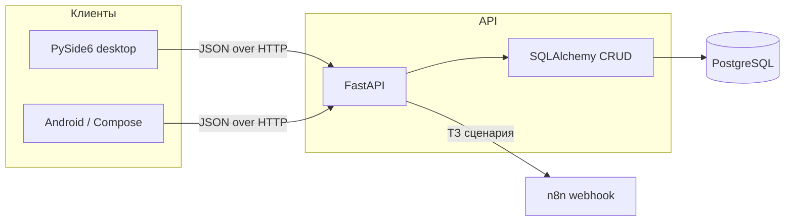

# Scenica

**Информационная система управления театром**: учёт сотрудников, театров, залов
и франшиз, репертуар (сценарии, акты, части), показы, клиенты и билеты,
голосования, оборудование и услуги с арендой.

Система построена вокруг HTTP API на FastAPI и PostgreSQL. С ним работают два
клиента: десктопное приложение для сотрудников на PySide6 и мобильное приложение
для зрителей на Kotlin + Jetpack Compose. Отдельная интеграция передаёт файл
технического задания сценария во внешний workflow n8n.

## Возможности

- **Единый API** для всех сущностей предметной области: сотрудники, франшизы,
  театры, залы, сценарии, акты, части, показы, клиенты, билеты, голосования,
  оборудование, услуги и аренда.
- **Аутентификация и роли**: JWT-токены, хеширование паролей через bcrypt,
  ролевая модель (администратор, менеджер, сценарист, партнёр франшизы,
  пользователь) с правами на чтение и изменение.
- **Десктопный клиент**: выборки, поиск и сортировка, CRUD-диалоги, дашборд,
  фоновая загрузка данных, настройка прав по ролям.
- **Мобильный клиент (MVP)**: регистрация и вход, список театров и показов,
  схема мест, бронирования, «мои бронирования».
- **Работа с ТЗ сценариев**: загрузка файла, скачивание и отправка во внешний
  вебхук n8n для обработки.
- **Инфраструктура**: docker-compose для PostgreSQL и API, миграции схемы,
  автотесты на pytest.

## Стек

| Уровень | Технологии |
|---------|------------|
| API | Python, FastAPI, SQLAlchemy, Pydantic, Alembic-style SQL-миграции |
| База данных | PostgreSQL 16 |
| Десктопный клиент | Python, PySide6 (Qt), requests |
| Мобильный клиент | Kotlin, Jetpack Compose, Retrofit, Moshi, Hilt |
| Интеграция сценариев | n8n webhook |
| Запуск и тесты | Docker, docker-compose, pytest |

## Архитектура



Подробнее: [docs/ARCHITECTURE.md](docs/ARCHITECTURE.md).

## Быстрый старт

### 1. Окружение

Проекту нужен Python 3.11+ и, для API, доступная база PostgreSQL.
Создайте файл окружения из шаблона и задайте секрет:

```bash
cp .env.example .env
python -c "import secrets; print(secrets.token_hex(32))"
```

Полученное значение впишите в `SECRET_KEY`. Файл `.env` не коммитится в git.

### 2. Зависимости

```bash
python -m venv .venv
.venv\Scripts\activate        # Windows
pip install -r requirements.txt
```

### 3. База данных и API

Вариант с Docker (PostgreSQL и API поднимаются вместе):

```bash
docker compose up --build
```

Вариант локально (нужна запущенная PostgreSQL c параметрами из `.env`):

```bash
python -m api.setup_db
python start_api.py
```

API будет доступен на `http://localhost:8000`, документация —
на `http://localhost:8000/docs`.

### 4. Десктопный клиент

```bash
python start_app.py
```

Скрипт `launch_app.bat` запускает API и клиент через простое меню.

### 5. Мобильный клиент

Откройте каталог `android-client` в Android Studio и передайте адрес API:

```bash
# эмулятор
-PapiBaseUrl=http://10.0.2.2:8000/
# физическое устройство в той же сети
-PapiBaseUrl=http://<ip-компьютера>:8000/
```

## Тесты

```bash
python -m pytest
```

Тесты API и CRUD используют SQLite в памяти, поэтому запущенная PostgreSQL для
них не нужна.

## Структура проекта

```
api/                FastAPI: модели, схемы, CRUD, аутентификация, RBAC, публичный API
app/                конфигурация и клиент API для десктопного приложения
backend/
  repositories/     HTTP-обёртки над эндпоинтами API
  services/         бизнес-сценарии поверх репозиториев
frontend/
  views/            окна и диалоги PySide6
  ui/               .ui-файлы Qt и стили
android-client/     Android-приложение для зрителей
docs/               документация
migrations/         SQL-миграции схемы
scripts/            вспомогательные скрипты
tests/              автотесты pytest
```

## Документация

- [Архитектура](docs/ARCHITECTURE.md)
- [Описание API](docs/API_DOCS.md)
- [Запуск и переменные окружения](docs/RUNNING.md)
- [Руководство пользователя](docs/USER_GUIDE.md)
- [Роли и права доступа](docs/SECURITY_ROLES.md)
- [Рекомендации по безопасности](docs/SECURITY.md)
- [Сравнение подходов к доступу к данным](docs/COMPARISON.md)

## Логи десктопного клиента

`%LOCALAPPDATA%\Scenica\logs\client.log` (Windows).

## Лицензия

Проект распространяется под лицензией MIT — см. [LICENSE](LICENSE).
